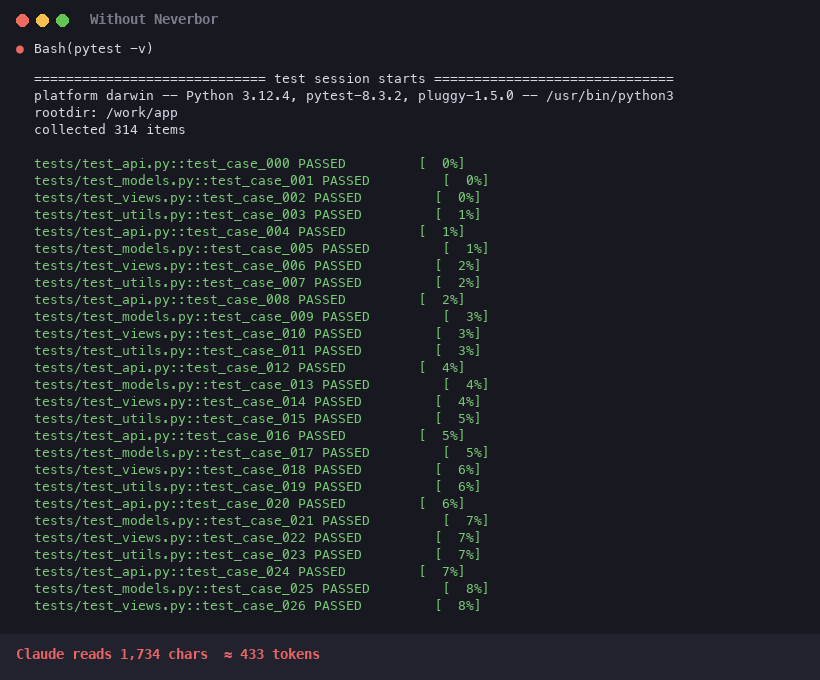

<div align="center">

# 🪶 Neverbor

**Плагин для Claude Code, который бережёт контекст и лимиты.**

Сжимает «шумный» вывод *до того*, как его прочитает модель, помнит ход работы после `/compact` и не даёт Claude ходить по кругу.


**до −96% символов** на длинных выводах · без прокси · без API-ключей · оригиналы всегда под рукой

[English](README.md)



</div>

---

## ✨ Возможности

- 🗜 **Сжатие вывода Bash и MCP.** Убирает цвета, прогресс-бары и повторы, сокращает длинный JSON и огромные логи.
- 🔁 **Ничего не теряется.** Полный оригинал сохраняется на диск, и Claude может прочитать его, если понадобится.
- ✂️ **Короткие ответы.** В начале сессии Claude получает правила: без вступлений, пересказов и лишних перечитываний.
- 🛡 **Безопасность прежде всего.** Точный вывод (`cat`, `git diff`, `Read`, `Edit`…) не трогается. Если хук упадёт, сессия продолжится как обычно.
- 🧠 **Понимает частые выводы.** Установка пакетов — одна строка вместо сотен. В ошибках со стеком вызовов убираются кадры из библиотек. Длинные списки файлов группируются по папкам.
- ♻️ **Повторы.** Та же команда с тем же выводом в этой сессии заменяется ссылкой на прошлый запуск.
- 🎚 **Режимы и конфиг.** `light`, `normal`, `aggressive` и файл настроек для тонкой подстройки.
- 📒 **Паспорт работы.** После `/compact` Claude снова знает, какие файлы менял и чем закончились команды, и не перечитывает всё заново.
- 🔄 **Без хождения по кругу.** Одна и та же ошибка три раза подряд — и Claude получает подсказку сменить подход.
- 🗺 **Карта проекта.** Папки, языки и команды сборки одной короткой справкой вместо долгого изучения.
- 📖 **Без лишних перечитываний** *(по желанию)*. Неизменённый файл при повторном чтении заменяется ссылкой на уже прочитанную копию.
- 📊 **Статистика.** `/neverbor stats today` покажет экономию за день и топ команд, а после ответа появится короткое сообщение, сколько токенов сэкономлено. Есть страница с графиком, советы по настройке и статус-строка.

## 📉 Замеры

| Команда | До | После | Экономия |
|---|---:|---:|---:|
| `ls -laR` по репозиторию | 74 702 | 6 981 | **−91%** |
| `find` по папке (2 900 файлов) | 303 371 | 18 328 | **−94%** |
| `grep -rn 'def '` | 242 930 | 37 566 | **−85%** |
| JSON на 150 issues | 24 683 | 1 192 | **−96%** |
| `pip install`, 60 пакетов | 15 088 | 1 143 | **−92%** |
| `pytest -v`, 314 тестов, 2 падают | 18 870 | 1 246 | **−93%** |
| стектрейс через flask/sqlalchemy | 10 392 | 1 236 | **−88%** |
| `git diff` *(с `compress_diff`)* | 8 372 | 984 | **−88%** |
| `cat Cargo.lock` | 139 846 | 139 846 | 0% *(намеренно)* |

<sub>Размеры в символах; токенов примерно в 4 раза меньше.</sub>

## 🚀 Установка

Внутри Claude Code:

```
/plugin marketplace add koigkio/Neverbor-Demo-plugin
/plugin install neverbor@neverbor
```

Или из терминала:

```bash
claude plugin marketplace add koigkio/Neverbor-Demo-plugin && claude plugin install neverbor@neverbor
```

После установки перезапустите сессию.

**Что нужно:** Python 3.8 или новее. Neverbor сам найдёт его под именем `python3`, `python` или `py`.

| Система | Что сделать |
|---|---|
| macOS | обычно ничего. Если Python нет, система при первом запуске предложит установить Command Line Tools — согласитесь |
| Linux | обычно ничего: Python 3 есть почти везде. Если нет — `sudo apt install python3` или аналог |
| Windows | установите Python с [python.org](https://www.python.org/downloads/) или из Microsoft Store |

Если Python не найден, плагин просто ничего не делает и Claude Code работает как обычно.

## 🎛 Команды

| Команда | Что делает |
|---|---|
| `/neverbor` или `/neverbor stats` | статистика экономии за всё время |
| `/neverbor stats today` · `week` | за сегодня или за неделю, с топом команд |
| `/neverbor on` · `/neverbor off` | включить или выключить сжатие |
| `/neverbor brief` | паспорт работы: что Claude получит после `/compact` |
| `/neverbor map` · `map on` · `map off` | карта проекта; `on` — добавлять её в начало каждой сессии |
| `/neverbor reread on` · `off` | ссылка вместо повторного чтения неизменённого файла |
| `/neverbor report` | страница с графиком экономии и топом команд |
| `/neverbor advise` | советы по настройке на основе вашей статистики |
| `/neverbor statusline` | экономия в статус-строке Claude Code (покажет, что добавить в настройки) |
| `/neverbor mode light` · `normal` · `aggressive` | насколько сильно сжимать |
| `/neverbor config` | показать настройки; `/neverbor config min_chars 4000` — изменить одну |
| `/neverbor terse on` · `off` | правила краткости (со следующей сессии) |
| `/neverbor quiet on` · `off` | «тихие» флаги для `npm install`, `pip install`, `git clone`, `cargo build` |

**Режимы.** `light` — только цвета, прогресс-бары и повторы, от 5 000 символов. `normal` — всё сжатие (по умолчанию). `aggressive` — длинные выводы обрезаются сильнее: 80 строк вместо 150.

**Тихие флаги** выключены по умолчанию. Когда включены, Neverbor дописывает к простой команде флаг вроде `-q` и **всегда** спрашивает ваше подтверждение на изменённую команду. Составные команды (`&&`, `|`, `$(…)`) не трогаются.

<details>
<summary><b>Тонкая настройка</b></summary>

Настройки лежат в `~/.claude/neverbor/config.json`. Менять их удобнее через `/neverbor config <ключ> <значение>`, сбросить — `/neverbor config <ключ> reset`.

| Ключ | По умолчанию | Что значит |
|---|---|---|
| `min_chars` | `2500` | выводы короче не сжимаются |
| `max_lines` · `head` · `tail` | `150` · `50` · `40` | длиннее `max_lines` строк остаются голова, хвост и все ошибки |
| `min_saving` | `0.15` | не сжимать, если экономия меньше 15% |
| `cache_days` | `3` | сколько дней хранить оригиналы |
| `passthrough` | `""` | свои команды-исключения, regex: `rg\|kubectl` |
| `compress_diff` | `false` | сжимать контекст в `git diff` (все `+`/`-` строки остаются) |
| `rules_extra` | `""` | своё правило к правилам краткости |
| `lang` | `"en"` | язык сообщения об экономии: `en` или `ru` |
| `brief` | `true` | паспорт работы после `/compact` |
| `reread` | `false` | ссылка вместо повторного чтения файла |
| `map_on_start` | `false` | карта проекта в начале сессии |

Ещё:
- `# neverbor:off` в конце bash-команды отключает сжатие только для неё.
- `NEVERBOR=0` выключает сжатие через окружение, `NEVERBOR_TERSE=0` — правила краткости, `NEVERBOR_QUIET=1` включает тихие флаги.
- `NEVERBOR_PASSTHROUGH='rg|kubectl'` важнее `passthrough` из конфига.
- `NEVERBOR_DEBUG=1` выводит ошибки хука в stderr.

</details>

## ⚙️ Как это работает

```
Claude вызывает Bash / MCP-инструмент
        │  сырой вывод (логи, find, grep, JSON…)
        ▼
PostToolUse-хук  scripts/post_tool.py
        │  0. та же команда и тот же вывод уже были в сессии? → ссылка на прошлый запуск
        │  1. убирает ANSI-цвета и перерисовки прогресс-баров (\r)
        │  2. режет минифицированный JS/base64 (длинные строки без пробелов)
        │  3. строки загрузки пакетов → счётчик
        │  4. стектрейсы: кадры из библиотек → «… N library frames»
        │  5. схлопывает повторяющиеся и однотипные строки
        │  6. JSON: минифицирует, длинные массивы → первые 5 + последние 2 + «ошибочные»
        │  7. >150 строк: голова + хвост + все строки с error/fail/warning/traceback
        │  8. оригинал → ~/.claude/neverbor/cache/…, в конце вывода ссылка на него
        ▼
Claude видит сжатую версию и может прочитать оригинал, если нужно
```

- `SessionStart` добавляет в контекст правила краткости, и так уменьшаются ещё и **выходные** токены. После сжатия контекста (`/compact`) он сбрасывает память о повторах, чтобы Claude снова видел выводы целиком.
- `Stop` после ответа, где экономия больше 300 токенов, показывает вам короткое сообщение. В контекст модели оно не попадает.
- `PreToolUse` работает, только если включены тихие флаги.
- `PostToolUse` для `Edit`/`Write` ведёт журнал сессии: какие файлы менялись. `PostToolUseFailure` записывает упавшие команды и замечает повторяющиеся ошибки. Из журнала собирается паспорт работы после `/compact`.
- Журнал хранится локально в `~/.claude/neverbor/sessions/` и никуда не отправляется.

## 🛡 Что не сжимается

- Вывод короче 2 500 символов или с экономией меньше 15%.
- Команды точного просмотра: `cat`, `head`, `tail`, `sed`, `awk`, `jq`, `diff`, `git diff/show/blame` и т. п. Для diff это можно включить ключом `compress_diff`.
- Инструменты `Read`, `Edit`, `Grep`: при правках Claude нужен точный текст. Единственное исключение — `reread on`: тогда повторное чтение неизменённого файла заменяется ссылкой, а если Claude попросит файл ещё раз сразу после этого, получит его целиком.
- Команды, которые завершились с ошибкой: Claude Code не даёт менять их вывод.

Оригиналы хранятся 3 дня (`cache_days`) в `~/.claude/neverbor/cache/`.

## 🗺 Планы

- [x] Тихие флаги через `PreToolUse` — `/neverbor quiet on`.
- [x] Сжатие `diff`: ±3 строки контекста — ключ `compress_diff`.
- [x] Установка пакетов, стек вызовов, повторы, режимы, настройки, сообщение об экономии.
- [x] Паспорт работы после `/compact`, подсказка при повторяющихся ошибках, карта проекта, отчёт и советы.
- [ ] Больше форматов: `docker build`, `terraform plan`, `kubectl get`.
- [ ] Сжатие длинных таблиц (`ls -la`, `ps aux`): оставлять нужные столбцы.

## 📄 Лицензия

[MIT](LICENSE) © koigkio
